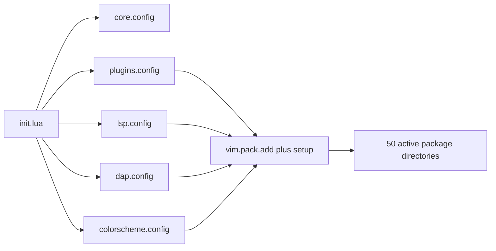

# Neovim configuration audit

Audit date: 2026-10-25

This is a read-only audit of `nvim/.config/nvim`. No Neovim configuration or lockfile was changed.
The generated documentation and the root README are the only intended repository changes.

## Executive summary

- Detected Neovim: **0.12.5**, release build, LuaJIT 2.1.
- Plugin manager: Neovim's native, experimental `vim.pack` manager with a checked-in
  `nvim-pack-lock.json` containing **50 repositories**.
- Current loading: every locked repository becomes active during startup. Configuration modules call
  `vim.pack.add()` and `require()` synchronously; there is no event, command, filetype, or key based
  lazy loader.
- Measured headless startup: **87.870 ms mean** over five warm runs; clean Neovim averaged **5.964
  ms** in the same harness.
- Startup succeeds without a Lua error when the repository config is selected explicitly.
- The highest priority compatibility issue is the frozen `nvim-treesitter` `master` branch. Its
  installed documentation says that branch does not support Neovim 0.12.
- The highest priority mapping issue is a group of buffer-local, nonrecursive self mappings in the
  LSP attach callback. They shadow Neovim 0.12's global LSP defaults instead of restoring them.
- The lockfile is internally consistent with the installed plugin checkouts. Most locked commits are
  from 2026, so the checkout does not appear to be six months stale. Remote update availability was
  not checked during this read-only phase.

See [plugins.md](plugins.md), [keymaps.md](keymaps.md), and [recommendations.md](recommendations.md)
for the complete inventories and action plan.

## Detected environment

| Item                     | Result                                                                                                                      | Verification                                       |
| ------------------------ | --------------------------------------------------------------------------------------------------------------------------- | -------------------------------------------------- |
| Neovim                   | 0.12.5                                                                                                                      | `nvim --version`                                   |
| Plugin manager           | Native `vim.pack`                                                                                                           | 41 `vim.pack.add()` call sites and native lockfile |
| Locked repositories      | 50                                                                                                                          | Counted lockfile plugin keys                       |
| Active at startup        | 50 of 50                                                                                                                    | `vim.pack.get(nil, { info = false })` after init   |
| Config deployment        | Not deployed in this audit container                                                                                        | `~/.config/nvim` does not exist                    |
| Git                      | Available                                                                                                                   | Required by `vim.pack`                             |
| Search tools             | `rg`, `fd`, `sd` available                                                                                                  | Used by pickers/Spectre                            |
| C/C++ tools              | `clang`, `clangd`, `clang-format`, `lldb-dap` available                                                                     | Executable lookup                                  |
| Missing configured tools | `ty`, `ruff`, `neocmakelsp`, `basedpyright-langserver`, `codelldb`, `gersemi`, `stylua`, `ctags-universal`, `diff-so-fancy` | Executable lookup and `:checkhealth`               |

The missing tools are verified for this machine only. Optional overrides from `local_paths.lua`
could supply non-PATH locations on another deployment; that optional file was absent here.

## Architecture and initialization sequence

The entry point is `nvim/.config/nvim/init.lua`:

1. Enable `vim.loader`.
2. Prepend flat `core` and `plugins` directories to `package.path`.
3. Load `core.config`, which loads paths, filetypes, options, global mappings, and autocommands.
4. Load `plugins.config`, which installs/activates and configures general plugins in a fixed order.
5. Add flat LSP and DAP directories to `package.path`, then load `lsp.config` and `dap.config`.
6. Add the colorscheme directory to `package.path`, configure two themes, and select Kanagawa.
7. After init finishes, Neovim sources plugin runtime files from the accumulated runtime path.



Ordering is currently part of the dependency model. Examples include icons before consumers,
Gitsigns before the statusline, mini.pick before picker integrations, nvim-dap before DAP UI, and
theme setup after plugin highlight groups. This works, but the dependencies live in comments and
repeated `vim.pack.add()` calls instead of one inventory.

The flat `package.path` manipulation allows short names such as `require("config")` and
`require("paths")`. It also makes common module names globally ambiguous and hides ownership in
stack traces. Conventional names such as `require("core.paths")` would remove the mutations and make
navigation clearer.

## Findings by severity

### Critical

#### C1. `nvim-treesitter` branch is incompatible with Neovim 0.12

**Verified.** `lua/plugins/nvim-treesitter-config.lua:4` pins `version = "master"`. The installed
branch README states that `master` is frozen for backward compatibility, supports Neovim 0.10 and
0.11, and does not support 0.12. The current `main` branch is an incompatible rewrite requiring
Neovim 0.12 and a different setup API. It also explicitly says the plugin should not be lazy loaded.
See the current
[nvim-treesitter migration documentation](https://github.com/nvim-treesitter/nvim-treesitter/blob/main/README.md#quickstart).

Startup success does not establish feature compatibility. Highlighting, indentation, parser updates,
or future 0.12 patch releases can fail. Treat migration as a focused compatibility change: rewrite
the Tree-sitter module for `main`, update parsers in the same change, and verify every configured
language.

#### C2. LSP self mappings suppress Neovim's default LSP mappings

**Verified at runtime.** `lua/lsp/lsp-base-config.lua:72-80` installs buffer-local mappings such as
`K -> K`, `gri -> gri`, and `gra -> gra` with `noremap = true`. Nonrecursive RHS keys do not invoke
the shadowed global mapping. They execute the underlying Normal-mode keys. The same problem exists
for `<C-w>d -> <C-w>d` in `diagnostic-default-config.lua:75`.

Neovim 0.12 creates global mappings for `gra`, `gri`, `grn`, `grr`, `grt`, `grx`, `gO`, and insert
`<C-s>`, and creates `K` on LSP attach when appropriate. The effective buffer-local map dump showed
all of the self mappings with `noremap=1`. Replace them with direct function mappings or remove the
custom `gc`/`gr` prefixes so the native defaults remain reachable. The official list is in
[Neovim's LSP defaults](https://neovim.io/doc/user/lsp#lsp-defaults).

### Warning

#### W1. LSP `gc` and `gr` mappings conflict with built-in mapping families

**Verified statically and at runtime.** On attach, `gc` becomes LSP declaration and `gr` becomes LSP
references. `gc` shadows Neovim's comment operator family (`gc`, `gcc`), while `gr` is a prefix of
the built-in LSP family. With `timeoutlen=5000`, exact/prefix ambiguity can produce a wait of up to
five seconds. Prefer Neovim's `gr...` defaults and put declaration on a nonconflicting key such as
`gD` or a leader mapping.

#### W2. Configured external tools are missing

**Verified on this machine.** Health checks report unavailable `gersemi`, `ruff`, and `stylua`
formatters; `neocmakelsp`, `ruff`, and `ty` LSP configurations cannot start. DAP health reports the
registered `codelldb` adapter executable is missing. The configured `ctags-universal` and
`diff-so-fancy` commands are also absent. Feature calls will fail or silently do nothing even though
startup succeeds.

#### W3. Both C/C++ DAP configurations are loaded, but one overwrites the other

**Verified.** `dap/config.lua` loads CodeLLDB and then `lldb-dap`; both assign
`dap.configurations.c` and `.cpp`. The effective tables contain only the later `lldb-dap`
configurations. The `codelldb` adapter remains registered and causes a health error even though no
effective launch configuration uses it. Choose one adapter, or merge both launch entries with
distinct names.

#### W4. Deprecated Neovim APIs remain

**Verified.** `indent-blankline-nvim-config.lua:15-17` uses `vim.loop`, deprecated since Neovim 0.10
in favor of `vim.uv`. Several buffer-local mappings use the `buffer` option, renamed to `buf` in
Neovim 0.12. `:checkhealth vim.deprecated` also found `visimatch.nvim` using the deprecated table
form of `vim.validate`; this last issue is upstream plugin code rather than local configuration. See
[Neovim's deprecation list](https://neovim.io/doc/user/deprecated).

#### W5. Plenary is no longer actively maintained

**Verified from the installed repository README.** It says critical fixes ended on 2026-06-30 and
ongoing support should not be expected. Neo-tree, Harpoon, and Spectre currently depend on it, so
removing it directly would break those plugins. Track their dependency plans and avoid adding new
direct uses.

#### W6. Mapping descriptions contain confirmed errors

**Verified.** Harpoon's `hn` calls `prev()` but says “next”; `hp` calls `next()` but says “prev”.
Oil's window-local `cd` says “tab”, and its preview scroll descriptions are reversed. Conform's
format mapping passes an undefined global `desc`, producing a mapping with no description. The
mapping inventory lists each case.

#### W7. Several aliases are duplicate mappings

**Verified in the effective map table.** `<A-x>` and `<M-x>` are aliases in Neovim; defining both
causes the second definition to replace the first. This affects all eight navigation, resize, and
floating-window pairs. Keep one spelling consistently.

#### W8. The active and dormant inventories are mixed in source files

**Verified.** `hardtime-nvim-config.lua` and `trailing-whitespace-nvim-config.lua` exist but are
commented out in `plugins/config.lua`; `nvim-dap-cppdbg-config.lua` is also disabled. A reader can
mistake these for installed functionality. Mark dormant modules clearly or move them under a
`disabled/` directory after confirming they are worth retaining.

### Improvement

#### I1. Plugin specifications are scattered and duplicated

Dependencies such as `mini.icons`, `plenary.nvim`, `gitsigns.nvim`, `nvim-dap`, and
`nvim-dap-virtual-text` are added repeatedly. A single native pack specification module would be the
authoritative installation inventory, while setup modules would only configure behavior. This does
not require changing plugin managers.

#### I2. Some active plugins provide no current value

- `mini.bufremove` is configured, but `<leader>bd` calls built-in `:bdelete` and no code calls
  `MiniBufremove`.
- Vague is configured and activated, but Kanagawa is always selected.
- `symbol-usage.nvim` is initialized and immediately disabled globally.

These are candidates for removal or delayed setup, subject to normal interactive verification.

#### I3. Several option assignments repeat Neovim defaults

Runtime comparison found redundant assignments for `autoindent`, `hlsearch`, `incsearch`,
`showmatch=false`, `cmdheight=1`, `pumblend=0`, `winblend=0`, `conceallevel=0`, `concealcursor`,
`hidden`, `errorbells=false`, `backspace`, `autochdir=false`, `selection=inclusive`,
`modifiable=true`, `encoding=utf-8`, and `wildmenu`. Removing them would shorten the configuration;
keeping a few as explicit documentation is also reasonable.

#### I4. Two icon providers and two file explorers are active

`mini.icons` and `nvim-web-devicons` are both configured because consumers use different APIs. Oil
and Neo-tree provide different workflows and do not currently fight for directory takeover: Oil is
the default file explorer while Neo-tree disables netrw hijacking. This is redundancy, not a
confirmed conflict. Keep both if both workflows are used.

#### I5. Global view save/load autocommands are broad

`BufWinLeave` and `BufWinEnter` run `mkview`/`loadview` for `*`, including special buffers, with all
errors suppressed. Restricting them to normal file buffers would reduce hidden work and make errors
observable. This is a potential issue; no data loss or runtime failure was reproduced.

#### I6. A latent error exists in the local-cwd warning path

`core/keymaps.lua:153` concatenates `path("'")`, which attempts to call a string if the invalid-path
branch is reached. Normal file buffers and the startup buffer did not reach the branch. Change it to
`path .. "'"` when implementing fixes.

## Plugin loading and performance

### Current behavior

All 50 locked repositories returned `active=true` from `vim.pack.get()` immediately after startup.
The general plugin phase accounts for about 42 ms, LSP for 21 ms, DAP for 7.5 ms, and colors for 4.8
ms in the representative run. Large individual setup chains included icons (4.4 ms), mini.surround
(4.5 ms), Harpoon (3.5 ms), indent guides (2.9 ms), Spectre (2.7 ms), and nvim-treesitter (2.6 ms).
These figures include sourced dependencies and vary between runs.

| Measurement                        | Runs |      Mean |                   Range |
| ---------------------------------- | ---: | --------: | ----------------------: |
| Repository config, headless        |    5 | 87.870 ms |        86.187-90.594 ms |
| `nvim --clean`, headless           |    5 |  5.964 ms |          5.614-6.868 ms |
| Approximate config/plugin overhead |    5 | 81.906 ms | Not independently timed |

Reproduction harness:

```bash
XDG_CONFIG_HOME="$PWD/nvim/.config" \
  XDG_STATE_HOME="$PWD/.tmp-nvim-state" \
  XDG_CACHE_HOME="$PWD/.tmp-nvim-cache" \
  nvim --headless --startuptime nvim-startup.log +qa
```

The audit used an isolated writable state/cache and already installed plugin checkouts. These are
warm, no-file, headless numbers. They exclude terminal rendering, first-time plugin installation,
parser compilation, LSP startup, opening a real project, and cold filesystem cache effects.

### What should remain eager

- The selected colorscheme.
- Tree-sitter: both the frozen and current branches explicitly reject lazy loading.
- Any desired global UI overrides (`vim.notify`, `vim.ui.input`, and `vim.ui.select`).
- Editing primitives expected immediately: pairs, commenting, move, surround, split/join.
- Statusline/tabline and always-on visual behavior.
- LSP registration early enough to handle the first matching file buffer.

### Good lazy-loading candidates

- DAP core, adapters, UI, and virtual text on the first DAP action.
- Neo-tree, Oil UI setup, Harpoon, Snipe, Spectre, Floaterm, and No Neck Pain on their command or
  key entry points.
- Conform because format-on-save is disabled and formatting is currently manual.
- Goto Preview, Actions Preview, and Symbol Usage on LSP attach or their first action.
- The unused Vague theme and `mini.bufremove` should first be evaluated for removal.

Gitsigns, completion, indentation guides, and other buffer effects can be delayed to `BufReadPre`,
`InsertEnter`, or `FileType`, but the savings are small and the first-buffer event ordering must be
tested carefully.

### Is native `vim.pack` suitable?

Yes for installation, locking, updates, deletion, and this configuration's current size. Neovim's
official documentation calls it experimental but stable enough for daily use. It installs into
`site/pack/core/opt`, records exact revisions in the lockfile, and supports a `load` option.
[The official `vim.pack` documentation](https://neovim.io/doc/user/pack#vim.pack) does not provide
declarative `event`, `cmd`, `ft`, dependency, or key triggers.

True lazy loading therefore needs small custom stubs/autocommands that call `vim.pack.add()` and the
relevant setup module on demand. This is reasonable for a few expensive feature groups. Doing it for
every small plugin would recreate a plugin manager and add ordering risks. A migration to a
third-party lazy manager is not justified by the measured 88 ms baseline alone.

## Validation performed

- Parsed all 65 Lua files with `loadfile` inside Neovim: passed.
- Started the complete config headlessly with isolated writable state/data/cache: passed.
- Queried all managed plugins: 50 of 50 active.
- Compared actual installed Git HEADs with all 50 lockfile revisions: matched.
- Dumped effective global mappings and compared them with `nvim --clean` defaults.
- Materialized and dumped buffer-local LSP mappings by invoking the attach mapping function.
- Opened an Oil buffer and dumped its effective local mappings.
- Opened a tracked Lua file, waited for Gitsigns attach, and dumped its local mappings.
- Triggered the C++ ftplugin and verified local `<`/`>` pair mappings.
- Ran `:checkhealth` and `:checkhealth vim.deprecated`.
- Measured five config and five clean startup runs.

The full health check's `vim.pack` revision errors were artifacts of the read-only symlink fixture:
Git walked up to the repository root when inspecting the symlinked package directories. Direct
inspection of each real package checkout confirmed that every installed HEAD matches its lockfile
revision. Those fixture errors are excluded from the findings.

## Not verified

- Interactive UI behavior, terminal key transport, clipboard integration, and GUI-specific keys.
- Real LSP attachment to a project: this repository contains no matching C/C++/Python/CMake source,
  and several configured servers are missing. The mapping attach function itself was verified.
- A real DAP session.
- Remote plugin freshness. No `vim.pack.update()` or network mutation was run in the read-only
  phase.
- Tree-sitter highlighting and indentation across all configured languages under Neovim 0.12.
- Plugin behavior after proposed lazy loading; no loading change has been implemented.
